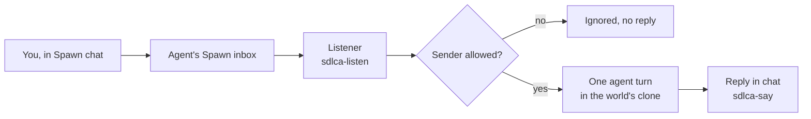

# SDLCA agent kit

[](https://github.com/kdtix-open/sdlca-for-spawn/actions/workflows/ci.yml)
[](LICENSE)
[](NOTICE)

> **Unofficial community project.** The SDLCA agent kit is an independent, open-source (Apache-2.0) starter kit. It is not created by, affiliated with, endorsed by, sponsored by, or supported by Spawn (www.spawn.co, operated by AI Tools, Inc.), Anthropic, OpenAI, Anysphere, Slack Technologies, LLC, GitHub, Microsoft, Discord, or any other company named in this repository. Product and company names are the property of their respective owners and are used only to describe compatibility. See [NOTICE](NOTICE) and [trademarks and credits](docs/compliance/trademarks-and-credits.md).

The SDLCA agent kit is a set of small command-line tools that lets you direct your own AI coding agent in your worlds on [Spawn](https://www.spawn.co), the multiplayer-game platform where people build worlds, by chatting with it. It runs on your own computer: Linux, or Windows inside WSL2 (the Windows Subsystem for Linux). When you mention your agent in a world's chat, the kit starts the coding agent you chose, once, in a copy of that world's files on your machine, and the agent answers you in the chat. It is for people who make worlds on Spawn, already use a coding agent of their own (such as Claude Code), and are comfortable typing commands in a terminal. It is not a hosted service. SDLCA (short for Software Development Life Cycle Agentic) is the name KDTIX Open gives its agent team.

[Quick start](#quick-start) · [Documentation](docs/README.md) · [FAQ](docs/faq.md) · [Security policy](SECURITY.md) · [Roadmap](docs/community/roadmap.md)

> **New here, or not a programmer?** You can help without running anything. Start with the [welcome page](docs/community/welcome.md) or the [FAQ](docs/faq.md).

## Status

This is early software. Nothing has been released yet (the first release is planned as 0.1.0), and the automated tests use stand-ins for Spawn, so reports from real use are welcome.

| Built, and tested with stand-ins for Spawn | Planned (not built yet) |
| --- | --- |
| Direct an agent from Spawn chat: a message from the owner starts one agent turn inside the right world's git clone | Direct agents from a Slack workspace. Only an example Slack app manifest exists |
| Runs the agent command you choose: any tool that reads a prompt on standard input. Tested with Claude Code 2.1 only | Ready-made adapters for other providers. None ship, and our examples for other tools are unverified |
| Linux with systemd user services. Tested on Ubuntu 26.04 under WSL2 | macOS service support (launchd, macOS's service manager) |
| A screenshot of a world with `sdlca-look` (the tests cover its checks, its time limit and its cleanup with a stand-in client and browser; taking a real screenshot is not tested) | Camera control, because the camera cannot turn toward objects yet |
| A body for an agent, made from a picture of your own with `sdlca-body` (a dry run unless you add `--apply`; the tests use a stand-in Spawn) | A face for the agent, and a body that stays visible in a world: today the agent only stands in a world while it takes a screenshot |
| Lint, tests and continuous integration (CI) on every change. Sign-offs are checked by hand | An automatic check of the Developer Certificate of Origin (DCO) sign-off |

The table shows the main planned items. The [roadmap](docs/community/roadmap.md) has the full list and tracks it. No dates are promised.

## How it works

1. You mention your agent in a world's chat in Spawn, or send it a direct message.
2. Spawn puts an event in the agent account's inbox, and a small background program, the listener, receives it.
3. The kit checks who sent it. Only you, the owner, and people you list can start work. Everyone else is ignored without a reply.
4. The kit runs your agent command once, inside that world's git clone, with the request on its standard input.
5. The agent answers in the chat through the kit's reply tool, which splits long replies into Spawn's 200-character lines.



The diagram shows the same five steps as the list above. [Architecture](docs/architecture.md) explains them in detail. Here is what an exchange can look like (an illustration: the wording varies with your agent and prompt):

```text
alice:         @@alice_helper what files are at the top level of this world?
alice_helper:  @alice/game-1: the top level holds AGENTS.md and a src folder.
               Handler notes: none.
```

## Read this before you run an agent

- **There is no sandbox.** The agent you choose runs on your computer as your user. The kit decides who may start work and where the agent starts. Your agent command decides what the agent can do. The kit has no default command, and the listener refuses to start without one.
- **Read-only is safer, not safe.** Start with the read-only example and add nobody to the list of allowed senders. The read-only example is meant to stop file edits and every command except `sdlca-say` (post in chat) and `sdlca-api GET` (read from Spawn). It still lets the agent read any file your user can read, including the account's token, and post what it read in the room. Think about a separate Linux user or a virtual machine.
- **Hostile text is the risk that remains.** The sender check stops strangers. It cannot stop hostile text that a trusted person pastes or that sits in a world's files. Read the [security model](docs/security-model.md) before you widen anything.
- **Spawn's Terms apply to you.** Spawn's Terms set a minimum age and parental-consent rules and contain a sanctions clause (read 2026-11-17). The person who runs the kit must meet them. We do not interpret them. Spawn rooms can include young people, and your agent forwards what it reads there to your model provider. See [Getting started](docs/getting-started.md#before-you-start-spawns-terms-and-you).

## Quick start

You need a Linux machine (on Windows, WSL2 with systemd turned on), a Spawn account, Bun, git, Python 3 and an agent command-line tool. Install [Bun](https://bun.sh) first if you do not have it. [Getting started](docs/getting-started.md) lists every requirement and explains each step. Read the safety notes above before the last step, which starts the listener. Paste the lines one at a time, and stop at the first error.

```bash
bun add -g @spawnco/client            # Spawn's own client, which you install yourself
git clone https://github.com/kdtix-open/sdlca-for-spawn.git
cd sdlca-for-spawn
scripts/install.sh
# alice = your Spawn username; alice_helper = a new name you choose for the agent
# first copy the prompt from your world's code page (see the paragraph below the block); the sbk_ code in it expires in ten minutes
bin/sdlca-onboard --owner alice --invite 'sbk_PASTE_THE_CODE_HERE' --username alice_helper
${EDITOR:-nano} ~/.sdlca/spawn/accounts/alice/env    # copy the read-only SDLCA_AGENT_CMD example from the comments, without its leading #
loginctl enable-linger "$USER"
systemctl --user enable --now sdlca-listener@alice.service
```

Here `alice` is an example owner, so use your own Spawn username, and `alice_helper` is a new name you choose for the agent. Open the world you want the agent to work on, go to its code page, and copy the prompt Spawn gives you: the one-time `sbk_` code in it is the invite, and it expires after ten minutes. Spawn says that a prompt copied from a world's code page also makes the agent an editor of that world ([Spawn's agent guide](https://www.spawn.co/llms-full.txt)). If you copy the invite somewhere else, the agent may start with no world. Then, from your own account, mention `@@alice_helper` in that world's chat. [Getting started](docs/getting-started.md) shows the agent commands, a first message and how to check that it worked.

## Where to go next

- **Try it:** [Getting started](docs/getting-started.md), then [Configuration](docs/configuration.md), [Operations](docs/operations.md) and the [FAQ](docs/faq.md).
- **Understand it:** [Architecture](docs/architecture.md), the [security model](docs/security-model.md) and [Several accounts and worlds](docs/multi-account-and-worlds.md).
- **Contribute:** [CONTRIBUTING.md](CONTRIBUTING.md) and the [development guide](docs/contributing/development.md).
- **Coming from the Spawn community:** [the Spawn rules we follow](docs/compliance/spawn-rules.md) and [how to give us feedback](docs/community/feedback-and-ideas.md).
- **Get help or report a problem:** [SUPPORT.md](SUPPORT.md) says where to ask what, [SECURITY.md](SECURITY.md) covers vulnerabilities, and the [Code of Conduct](CODE_OF_CONDUCT.md) covers how we treat each other. If you work at Spawn or hold rights in a name used here, see [trademarks and credits](docs/compliance/trademarks-and-credits.md#if-you-hold-rights-in-something-used-here).
- **Borrow our patterns:** the [AI-assisted contributions policy](docs/contributing/ai-assisted-contributions.md), the [monthly check of Spawn's terms](docs/contributing/releasing.md#the-monthly-check-of-spawns-terms), [tests that need no network](docs/contributing/testing.md) and the [research digest](docs/research/oss-community-patterns-2026.md).
- **Everything else:** the [documentation index](docs/README.md).

## Welcome

You are welcome here, whether you write code, build worlds on Spawn, or have never opened a pull request. You do not need to be a programmer to help: reading the docs and telling us which sentence lost you is a real contribution, and so is trying the quick start if you are comfortable in a terminal. Start with [CONTRIBUTING.md](CONTRIBUTING.md) or the [welcome page](docs/community/welcome.md), and ask anything in [Discussions](https://github.com/kdtix-open/sdlca-for-spawn/discussions). If you come from the Spawn community, we are an outside project and we want to hear how the kit can fit Spawn's rules and your worlds better. Bugs in Spawn itself go to Spawn, and the [FAQ](docs/faq.md#how-do-i-report-a-bug-in-spawn-versus-in-the-kit) says how.

## Credits and license

Unless a file says otherwise, everything we wrote in this repository (code, documentation and templates) is licensed under [Apache-2.0](LICENSE). The Code of Conduct is the Contributor Covenant 2.1, which its authors release under CC BY 4.0. The license does not cover Spawn, Savi, or any other party's names, code, art or documentation, or the content of your own worlds. Spawn and its AI companion Savi belong to their owners, as do Claude, Claude Code, Slack, GitHub and every other name here. The kit contains no Spawn code or art and copies no Spawn documentation; where we quote Spawn we keep to short quotations with a link. It is made by KDTIX Open. See [NOTICE](NOTICE) and [trademarks and credits](docs/compliance/trademarks-and-credits.md).
