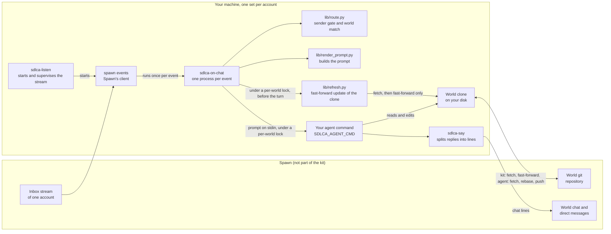
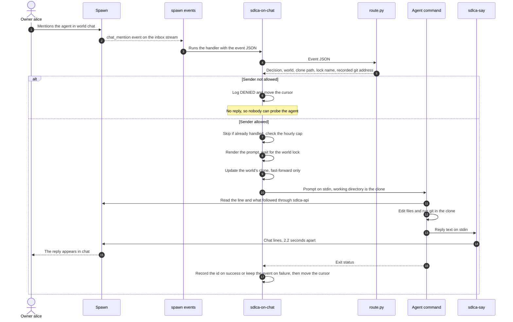

# Architecture

This page is for a technically curious person deciding whether to trust and run the SDLCA agent kit, and for a contributor who needs the mental model before changing it. You will learn what the parts are, what happens to one chat message from start to finish, why the design looks the way it does, and what the kit deliberately leaves out. It was checked against the kit's code on 2026-11-17, and its parts about the git address and `sdlca-look` on 2026-11-18.

The kit is an unofficial community project. It is not made, reviewed or supported by Spawn. For setup, see [Getting started](getting-started.md). For the trust questions, see [Security model](security-model.md).

## The big picture

The kit is a handful of small programs, written in shell and in Python that uses only the standard library, plus one small JavaScript file that takes screenshots. It has no server of its own and no database. Everything it remembers lives in plain files under one folder, the runtime home. Spawn's own client does the networking for the inbox. The kit adds three things on top:

1. A check of who may start work.
2. A choice of which world's clone the agent starts in, and an update of that clone, by fast-forward only, just before the turn.
3. A run of your agent command, with a prompt on its standard input, and a way for the agent to answer in chat.

A few words used on this page:

| Word | Meaning |
| --- | --- |
| Account | One Spawn account the kit acts as. In the kit it is a token file plus an env file. Its name is one word, or `group/name`. See [Several accounts and worlds](multi-account-and-worlds.md). |
| Owner | The Spawn user who may command an account. |
| Listener | The long-running process that watches one account's inbox (`sdlca-listen`). |
| Handler | The short process that deals with one inbox event (`sdlca-on-chat`). |
| Turn | One run of your agent command for one event. |
| World, clone | A Spawn world is a git repository. A clone is the copy of it on your disk. |
| Agent command | The shell command in `SDLCA_AGENT_CMD` that performs one turn. You choose it. |
| Runtime home | `$SDLCA_SPAWN_HOME`, by default `~/.sdlca/spawn`. Tokens, logs, cursors, the world registry and the allowlist live here. |

## The parts and how they connect



In words: the listener starts Spawn's client, which holds the account's inbox stream open. For every event the client starts the handler. The handler asks `lib/route.py` whether the sender is allowed and which world the event is about, builds a prompt, takes that world's lock, brings the world's clone up to date by fast-forward only (`lib/refresh.py`) and runs your agent command inside the clone. The agent edits the clone, pushes with git, and answers through `sdlca-say`, which posts to the world's chat.

The pieces, by file:

| Piece | File | Job |
| --- | --- | --- |
| Listener | [`bin/sdlca-listen`](../bin/sdlca-listen) | Starts Spawn's client for one account and hands every event to the handler. |
| Handler | [`bin/sdlca-on-chat`](../bin/sdlca-on-chat) | Deals with one event: gate, dedupe, cap, lock, agent run, cursor. |
| Classifier | [`lib/route.py`](../lib/route.py) | Reads an event, decides allow or deny, finds the world, names the lock and hands on the git address that `sdlca-worlds` recorded for the world. Prints one tab-separated line. |
| Prompt builder | [`lib/render_prompt.py`](../lib/render_prompt.py) with [`templates/handler-prompt.md`](../templates/handler-prompt.md) | Fills the prompt template. Uses `handler-prompt.md` from the runtime home when you have one. |
| Clone update | [`lib/refresh.py`](../lib/refresh.py) | Runs before an agent turn in a world's clone, given the clone and the world's recorded git address. Fetches the checked-out branch from that address (and from no other) and fast-forwards when that is a straight line, otherwise changes nothing and says why. Prints one tab-separated line (`STATUS`, `CODE`, `TEXT`) for the handler, and never fails a turn. |
| Shared shell code | [`lib/common.sh`](../lib/common.sh) | Account loading and checks, the origin check, the curl wrapper that keeps tokens off the command line (it runs `curl -q --globoff` and refuses a token with odd characters in it), log lines, `umask 077`. |
| Cursor, duplicates, cap | [`lib/cursor.py`](../lib/cursor.py), [`lib/dedupe.py`](../lib/dedupe.py), [`lib/ratelimit.py`](../lib/ratelimit.py) | The bookmark, the list of handled event ids, the runs-per-hour cap. |
| Chat output | [`bin/sdlca-say`](../bin/sdlca-say) with [`lib/linesplit.py`](../lib/linesplit.py) | Splits a reply into 200-character lines and posts them at a pace Spawn accepts. |
| Spawn API calls | [`bin/sdlca-api`](../bin/sdlca-api), [`lib/safeurl.py`](../lib/safeurl.py) | Authenticated calls that send the token only to the Spawn origin. `sdlca-api` also refuses a JSON body that starts with `@`, because curl would read a local file of that name and send it. The origin is checked with `common.sh`; the Python tools (`sdlca-say`, `sdlca-worlds`) use `safeurl.py`, which also refuses redirects. |
| World registry | [`bin/sdlca-worlds`](../bin/sdlca-worlds) with [`lib/gitcred.py`](../lib/gitcred.py) | Keeps `worlds.json` and the clones in step with Spawn, and records the git address that Spawn lists for each world (when it is one a credential helper can be attached to). `gitcred.py` builds each clone's git settings, with a credential helper for the world's git host only, and holds the one parser for a git address that `sdlca-worlds` and `lib/refresh.py` share. |
| Agent body | [`bin/sdlca-body`](../bin/sdlca-body) with [`lib/body.py`](../lib/body.py) | Run by a person, never by the agent. Gives an agent account a body made from a picture, or puts an existing body on it, through Spawn's character doors: upload, sculpt, wait, wear; or carries a model file to Spawn through a world's asset doors. A dry run until `--apply`; it never repeats a call that makes something, records a started sculpt in `body-sculpt.json` so that a second one is not started by accident, refuses an account that is not an agent, and runs only outside an agent turn. |
| Setup and helpers | [`bin/sdlca-onboard`](../bin/sdlca-onboard), [`bin/sdlca-token`](../bin/sdlca-token), [`bin/sdlca-friends`](../bin/sdlca-friends), [`bin/sdlca-allow`](../bin/sdlca-allow), [`bin/sdlca-as`](../bin/sdlca-as), [`bin/sdlca-look`](../bin/sdlca-look) with [`lib/shot.mjs`](../lib/shot.mjs) | Create an agent account from an invite, store and check a token (`sdlca-token`: `init`, `add`, `path`, `verify`, `list`), accept the owner's friend request, edit the allowlist, run a command as an account, take a screenshot (`sdlca-look`: only of a world the account serves, inside a time limit, and it always leaves; `--check` says what is missing). |

## Life of one event



In words: the owner's message becomes an event on the account's inbox stream. The handler either ignores it silently or runs one agent turn. The agent reads the conversation, does the work in the clone and answers through `sdlca-say`. When the agent exits, the handler records the outcome and moves the cursor.

### The steps in detail

**Before any event: the listener starts.** Systemd (or another supervisor you choose) runs `sdlca-listen <account>`. It does the following, in order:

1. Loads the account. The name is one word, or two words joined by one slash (`group/name`). A word is lowercase letters, digits, underscore or hyphen, and starts with a letter or digit. The env file must exist and must not be writable by group or others, because the kit runs it as shell. `OWNER`, `SPAWN_USERNAME` and `SPAWN_TOKEN_FILE` must be set, and the token file must be readable.
2. Exits with status 78 if `SDLCA_AGENT_CMD` is not set. The systemd unit does not restart on 78, so a missing setting does not turn into a restart loop.
3. Checks that the `spawn` command exists.
4. Reads the cursor file, if it holds anything, and passes it as `--since`.
5. Runs `sdlca-friends` once, so a friend request that arrived while the listener was down is still accepted. Its output goes to `listener.log`.
6. Replaces itself (`exec`) with `spawn events --kind chat_mention,friend_request,savi_finished,savi_needs_you`, with `--exec` pointing at the handler for this account. Standard output of the client is thrown away, because it carries other people's chat text. Standard error goes to `listener.log`.

After step 6 the client is the process that systemd supervises.

**For each event: the handler runs.**

1. **A new process starts** for every event, with the event JSON in `$SPAWN_EVENT` (the handler also reads standard input if that variable is empty). The handler loads the account again, so most settings take effect on the next event without a restart.
2. **The raw token is removed.** Spawn's client puts the token in `SPAWN_TOKEN` for the hook. The agent never needs it, so the handler unsets `SPAWN_TOKEN` and `SPAWN_EVENT` before anything else runs.
3. **The event is classified** by `lib/route.py`, which prints one line: kind, cursor, event id, decision, sender, world address, working directory, lock name and the world's recorded git address (a dash when there is none). If the event is not valid JSON the handler logs `ERROR event could not be parsed; skipped`, leaves the cursor alone and stops.
4. **The kind decides the path.**

   | Kind | What the handler does |
   | --- | --- |
   | `chat_mention` | Continues to the next step. |
   | `friend_request` | Runs `sdlca-friends`, which accepts a pending request from the account's owner and from nobody else. Then moves the cursor. |
   | `savi_finished`, `savi_needs_you` | Logs `SAVI-EVENT kind=...` and moves the cursor. The kit does nothing else with them. |
   | Anything else | Moves the cursor and stops. |

5. **The sender gate.** For a `chat_mention`, a decision other than `allow` ends the story: the handler logs `DENIED sender=<handle> reason=<reason>` (never the chat text), moves the cursor and sends no reply. The rules are under [The sender gate](#the-sender-gate).
6. **The agent command must exist.** If `SDLCA_AGENT_CMD` has been removed since the listener started, the handler logs an error and exits with status 1 without moving the cursor, so the event is delivered again later.
7. **Housekeeping, then the duplicate check.** First the handler deletes saved events in `run/failed/` that are more than `SDLCA_FAILED_KEEP_DAYS` days old (default 30; `0` keeps them forever). Then, if the event id is in `accounts/<account>/handled.ids`, the handler logs `SKIP event <id> was already handled`, moves the cursor and stops. The check is made again after the world lock is taken (step 10), so two copies of one event that arrive at the same moment run the agent once: the later copy logs `SKIP event <id> was already handled (another copy finished first)`. If `handled.ids` cannot be read, the handler logs a `WARN` line and treats the event as new, because a repeated turn is better than a lost one.
8. **The hourly cap.** `lib/ratelimit.py` counts agent runs started in the last hour (file `runs.log`). At `SDLCA_MAX_RUNS_PER_HOUR` (default 20) the handler logs `RATE-LIMITED`, keeps the event in `run/failed/` and moves the cursor. A value of 0 turns the cap off. If the cap cannot be checked (the value is not a whole number, or `runs.log` cannot be written), the handler logs `ERROR the run cap could not be checked` and leaves the event unhandled, with the cursor where it was.
9. **The prompt is built.** The handler logs `event sender=<handle> world=<address>`, then `lib/render_prompt.py` fills the template. The event goes into the prompt between `<untrusted_event>` tags, with every `<` written as `\u003c` so the text cannot forge the closing tag.
10. **The world lock is taken.** The handler waits for an exclusive lock on `run/<world owner>__<world>.lock` for at most `SDLCA_LOCK_WAIT` seconds (default 3600). If the wait runs out it logs `WARN the world was busy for too long; event kept in run/failed`.
11. **The clone is brought up to date.** Still holding the lock, and only for an event that matched a world, the handler runs `lib/refresh.py` on the clone, with the world's recorded git address (for a direct message there is no world, so nothing runs). The update fetches the branch that is checked out from that address and fast-forwards it when that is a straight line. Otherwise it changes nothing and says why. Without a recorded address it trusts nothing and runs no git (`skipped/unverified`). The handler logs one `WORLD <address> clone <status>/<code>: <text>` line and appends a paragraph to the prompt, in fixed wording, that tells the agent whether the clone is current. Nothing that git said goes into the prompt. The update has its own time limit, `SDLCA_REFRESH_TIMEOUT` (60 seconds for each git call, at least 600 for the fast-forward, `0` turns it off even when `lib/refresh.py` is missing), and the handler stops the whole update after four times that value plus 660 seconds. Its answer never fails the turn: a missing, crashed or timed-out update is logged as `failed/error` or `failed/timeout` and the agent still runs. It runs before the credentials are read, so git never has your provider keys in its environment. See [Why the kit updates the clone, and only by fast-forward](#why-the-kit-updates-the-clone-and-only-by-fast-forward).
12. **The credentials are read.** If you set `SDLCA_CREDENTIALS_FILE`, the handler first checked that it is readable (an unreadable file stops the turn before step 11), and now reads it as shell, so its variables reach the agent command and nothing before it.
13. **The agent runs.** Still holding the lock, the handler changes into the clone (or into the scratch folder, see [Routing rules](#routing-rules)), and runs the prompt through `timeout -k 10 $SDLCA_AGENT_TIMEOUT bash -c "$SDLCA_AGENT_CMD"`. Everything the agent prints is appended to `handler.log`. The agent command gets one more variable than the account env has, `SDLCA_TURN_ACCOUNT` (the account's name, set last so no file can change it), which tools that take an account as an argument use to refuse any other (`sdlca-look`), or to refuse to run at all (`sdlca-body`). The agent does not inherit the lock's file descriptor, so a background process it leaves behind cannot keep the world locked. `timeout` stops the agent and its process group; a process that detaches from the group on purpose (for example with `setsid`) is not stopped.
14. **The outcome is recorded.** Exit status 0 adds the event id to `handled.ids`, while the lock is still held. Any other status from the agent logs `WARN agent exited with status N` and keeps the event in `run/failed/<id>.json`. The handler uses the numbers 74, 75 and 76 for its own outcomes (credentials unreadable, world busy, already handled). Each has its own log line (`ERROR SDLCA_CREDENTIALS_FILE is not readable; event kept in run/failed`, the `WARN` about the busy world, and the `SKIP` line from step 7), and an agent command that exits with one of these numbers is logged as status 1.
15. **The cursor moves**, in every case that reached this step.

**During the turn,** the default prompt tells the agent to read the runtime home's `AGENTS.md` and `WORK-TODO.md`, to fetch the message and what followed through `sdlca-api GET '<actionData>'`, to do what was asked, and to answer through `sdlca-say`. The last paragraph of the prompt, written by the kit, says whether the clone was brought up to date. The agent may push to a world's `main` branch, which goes live in every open room, and the prompt tells it never to force-push: if a push is rejected it runs `git fetch`, then `git rebase --fork-point origin/main` (a plain rebase can bring back commits that the world removed), checks that its change still works and pushes again, or stops and tells the person if a conflict cannot be resolved. A push never publishes the world: publishing is a separate step the owner asks for. The text of the prompt is in [`templates/handler-prompt.md`](../templates/handler-prompt.md), and [Configuration](configuration.md#the-prompt-override) explains how to override it.

## Why one listener per account

Spawn gives each account its own inbox, and the stream that delivers it is opened with that account's token. A listener therefore belongs to one token. It cannot watch two accounts' inboxes, and two listeners on one token would receive the same events twice.

So the kit runs one listener per account. Each has its own:

- env file, token file and settings, so one account can be read-only and another a builder;
- cursor, because a cursor is a position in one inbox's history and means nothing for another;
- logs;
- systemd instance, `sdlca-listener@<account>.service`, so a refused token or a crash in one account does not stop the others. A systemd instance name cannot hold a slash, so the unit is for one-word account names, not `group/name` ones. See [Several accounts and worlds](multi-account-and-worlds.md#grouped-accounts-and-the-sdlca-token-command).

The cost is more processes: one small idle process per account. We think that is a fair price for clean separation.

## Why per-world locks

A world's clone is a git working tree. If two agent turns edit and commit in it at the same time, they trip over each other: half-finished edits, conflicting commits, a push that mixes two requests. A push to `main` also goes live in every open room, so a mix-up is visible to players. The rule is one writer per world, and the kit enforces it with a file lock held while the agent runs (a process that deliberately detaches itself is not covered).

Each turn takes an exclusive lock on `run/<world owner>__<world>.lock` before the agent starts, and holds it until the agent command ends. Turns for different worlds hold different locks and can overlap.

Why is the lock needed if one listener handles events one after another? Because there are other ways for two turns on one world to meet:

- **Two accounts can reach the same world.** The registry keeps one clone per world, shared by every account that reaches it, and the lock name comes from the world, not the account. See [Several accounts and worlds](multi-account-and-worlds.md).
- **You can replay a failed event by hand** while the listener is busy.
- **Spawn's client might start handlers in parallel.** A research note from an earlier code review says the client waits for each handler. We have not confirmed it, and the kit does not rely on it.

How the lock behaves:

- It is `flock`, so the kernel releases it when the holder exits. There are no stale lock files to clean up.
- A waiting turn gives up after `SDLCA_LOCK_WAIT` seconds, so one stuck turn cannot block a world forever.
- `timeout` stops an agent that hangs, which frees the lock.
- The agent does not inherit the lock, so a development server or watcher it leaves behind cannot hold it. The update of the clone does not either.
- The update of the clone (step 11) runs while the lock is held, so it cannot race another turn in the same world. The handler bounds it (four times `SDLCA_REFRESH_TIMEOUT` plus 660 seconds), so a hung update cannot hold the lock for ever; a turn that waits behind it counts that time against `SDLCA_LOCK_WAIT`.
- Events with no world use a lock of their own per account, `run/unrouted__<account>.lock`. Two accounts' unrouted events do not block each other. In a lock name, the slash of a grouped account becomes an underscore.

One honest limit: the lock covers the world the event was routed to. A direct message that asks the agent to work in a world is unrouted, so it holds the unrouted lock and not that world's lock. If the agent then changes into that world's clone, it can overlap with a turn that started from the world's own chat. If this matters to you, ask for work in the world's chat, not in a direct message.

## Why the kit updates the clone, and only by fast-forward

A clone is a copy that nobody keeps current. Before this step existed, the prompt told the agent to run `git pull` first, and that failed in the case the kit documents as its safest one: a read-only agent command cannot run git, so the agent answered from whatever was cloned earlier and said that "git pull was denied". In a world that other people push to, that goes stale quickly.

A plain `git pull` is also the wrong tool for a bot. It is a fetch plus a merge, so it can make a merge commit, rebase local commits, or stop in the middle with conflict markers in files the world runs, and a push of that lands on `main` and goes live in every open room. The safe rule is **fast-forward only**: move the local branch forward when it is a straight line from where it is, and otherwise change nothing and say why. A fast-forward never makes a merge commit or a conflict marker and never rewrites history, and with the options the kit uses it never overwrites a file you changed, an untracked file or an ignored file.

The kit cannot tell a read-only agent from a building one, because `SDLCA_AGENT_CMD` is only a command string. So the update is done by the kit itself, in `lib/refresh.py`, before the agent starts, and it has to be safe in both cases. These are the choices behind it:

- **Trusted code, not an instruction.** An instruction in the prompt works only if the agent can run git, and it runs with the agent's tool limits. This runs outside them, which is why it is careful about what it reads (see below).
- **Under the world's lock.** It cannot race another turn in the same world.
- **One address, recorded outside the clone.** The clone is a folder the agent may have written to, so the update does not ask it where the world is. `sdlca-worlds` records the git address that Spawn lists for the world in `worlds.json`, `lib/route.py` hands it to the handler and the handler to the update, which fetches from exactly that address (`git fetch -- <address> ...`, not through the name of a remote) and only when the clone's remote and credential helper agree with it. It reads the clone's settings before git reads any object, so a promisor remote that git would ask for a missing commit is refused too. An agent that rewrites the clone's remote, adds a remote that is called like the address, or copies the kit's helper line under another host's scope, gets a refusal and no request: [Security model](security-model.md#updating-the-clone-before-a-turn) says what is still open.
- **One branch, by fast-forward only.** It fetches the checked-out branch into a ref of its own (`refs/sdlca/refresh-tip`, and no `FETCH_HEAD`, which another git process or a link could change or write through), and into the tracking branch the clone's own fetch rule names for it (a fetch from an address does not write that on its own, and its reflog is what `git rebase --fork-point` reads), and runs `git merge --ff-only --no-overwrite-ignore`. It never merges, rebases, resets, checks out, cleans, stashes or forces. A change you have not committed is kept, and an update that would overwrite one, or an untracked or ignored file, is refused. It looks for lock files first, because git would otherwise write the files and only then find that it cannot move the branch.
- **Skipped is a normal answer.** A clone with unpushed commits (`ahead`), one that has diverged from the world (`diverged`, which is also what a force-push by the world, or a move back to an older commit, looks like), a detached head, a branch with no upstream and a world with no recorded address (`unverified`) are left alone and reported. The advice in the prompt for those cases uses `git rebase --fork-point`, because a plain rebase would put back commits that the world removed.
- **The agent is told in fixed words.** The handler ends the prompt with a paragraph chosen by the status and the code. Git's own text and any other string a remote can influence go to the log only, never to the prompt, so a hostile remote cannot write to the agent through the update.
- **It never fails a turn.** A missing, crashed, confused or timed-out update is logged as `failed/error` or `failed/timeout`, and the agent runs anyway, because a stale answer with a warning is better than no answer. The fast-forward is the one step that is not cut short by a short limit, because stopping a checkout half way leaves a half-updated work tree that every later update would refuse.
- **The clone is not trusted blindly.** An agent that can edit files can change `.git/config` and `.git/hooks`. The update turns hooks and the file system monitor off on the command line, allows https only, never lets git prompt, removes the environment variables that can redirect git, finds git only through absolute `PATH` entries, and reads the clone's own configuration first, before the fetch and again before the fast-forward. If that configuration can run a program, send git elsewhere (a proxy, a changed certificate check) or use a credential helper that is not the kit's or is scoped to another origin than the recorded address's, or if the clone's remote is not the recorded address, or if a link sits where git writes, it fetches nothing and reports `untrusted`. [Security model](security-model.md#updating-the-clone-before-a-turn) lists what this does and does not cover.

What it leaves out on purpose: a tool the agent itself can call to refresh (the agent would then be running trusted code on its own say-so), refreshing worlds other than the one the message came from, and the git notes that the clone's extra fetch rule names (the fetch names one branch, and a forced update of notes could overwrite a local note). For a direct message, which has no world, the prompt tells the agent that a clone may lag the latest push.

## Routing rules

Routing answers two questions: where does the agent start, and which lock does it take. `lib/route.py` answers them from the event and the registry in `worlds.json`.

| Situation | Working directory | Lock |
| --- | --- | --- |
| The event names a world this account serves | That world's clone, from the registry, which also supplies the world's recorded git address (the last field of the line) | `run/<world owner>__<world>.lock` |
| A direct message, or a world the registry does not know | `run/scratch/<account>`, a folder the kit makes for this | `run/unrouted__<account>.lock` |
| The world is known but its clone folder is gone | The scratch folder, without a warning | The world's lock |

The kit never starts the agent in the runtime home, because that folder holds every account's token.

How a world is matched:

1. **Only structured fields are read:** `relatedGameId`, `actionData`, `chat.world` and `chat.key`. The chat text and message text are never read, so what a person types cannot choose which clone the agent works in. A test checks this with a message that names a world in its text.
2. **Matching is by whole token, never by substring.** The fields are split at characters that cannot be part of an id or an address, and a registry entry matches only if one of its ids or names equals a whole piece. `@alice/game` never matches `@alice/game-2`, and `app-1` never matches `app-11`.
3. **Ids win over names.** The world id and the app id (with or without hyphens) are tried first, for every world. Only if no id matches does the kit try the world's address or one of its aliases, and then the first match in the registry wins.
4. **Only worlds this account serves are considered.** Each registry entry lists the accounts that reach it (written by `sdlca-worlds`, using the full `group/name` for a grouped account). A world is served when the account's full name (`alice`, or `group/name` for a grouped account) is in that list. The account's `OWNER` is not looked at. Only older entries with no `accounts` list fall back to comparing the owner part of the world's address with the account's `OWNER`.

If a registry file is missing, not valid JSON or not a JSON object, no world matches, and the turn runs in the scratch folder. The kit falls back to the safe place, not to a guess.

## The sender gate

Only some people may start an agent turn. The gate lives in `decide()` in [`lib/route.py`](../lib/route.py) and has these rules:

- The sender comes from the event's structured `chat.from` field and nowhere else. The handle is compared exactly as Spawn writes it, in lower case: a person is `@name`, an agent is `@@name`. A missing or odd-looking sender is denied (`unknown-sender`).
- The agent's own handle, `@@<SPAWN_USERNAME>`, is always denied (`self`). That prevents reply loops.
- The account's owner is allowed as `@<owner>`. An agent that happens to share the owner's name, `@@<owner>`, is not the owner.
- Extra senders come from `allowlist.json`, under `spawn.<owner>`. An entry such as `carol` or `@carol` means the person. An entry such as `@@helper` means an agent. Malformed entries, a value that is not a list and empty strings are ignored, so a typo never widens access.
- Everyone else, including another owner's account, is denied (`not-allowed`). If `allowlist.json` is unreadable, only the owner is allowed.
- A denied sender gets no reply, so nobody can probe whether an agent is listening. The log shows the handle and the reason, never the chat text.

Only `chat_mention` events can start a turn. Friend requests are accepted only from the account's owner. [Security model](security-model.md#who-can-trigger-work-and-how-that-is-enforced) explains what the gate does and does not protect.

## The cursor and at-least-once delivery

The *cursor* is a bookmark in the account's inbox: the newest event the kit has finished with. It lives in `accounts/<account>/cursor`.

- **When it moves.** After the handler has dealt with an event, whatever the outcome: a finished turn, a failed or timed-out turn, a denial, a duplicate, a rate-limited event, a friend request. It does not move when the event could not be parsed, when the agent command is missing, when the run cap could not be checked or when the prompt could not be rendered.
- **How it is written.** `lib/cursor.py` takes a lock (`accounts/<account>/cursor.lock`) around reading, comparing and writing, so two handlers that finish together cannot undo each other. It writes a temporary file and renames it over the cursor, with mode 0600, so a crash never leaves half a cursor. It never writes an empty value. It only moves forward: when it can decode both cursors (today they decode to a time and an id), an older one never replaces a newer one. A time with no zone is read as UTC, so it compares safely with one that has a zone. A value it cannot decode is written as given.
- **When it is read.** Only when the listener starts, as `--since`. While the listener runs, Spawn's client keeps its own position and reconnects by itself. With no cursor file the stream starts from now, so messages sent while the listener was down are not delivered.

This gives *at-least-once* delivery. If the machine stops after a turn has started and before the cursor moves, the event comes again after the next start. Two things keep that tolerable:

- **A finished turn is not run again.** The handler records the id of every event whose turn exits with status 0 in `accounts/<account>/handled.ids` (the newest 500 ids). A replay of a finished event is skipped.
- **An interrupted turn is run again.** It never reached status 0, so its id is not recorded. This is the "at least once" part: the owner may see a second answer, and the agent may repeat work such as a commit. The kit brings the clone up to date before each turn, by fast-forward only, so the second run starts from what the first one pushed. A commit that the first run made and did not push stays in the clone, and the second turn's `WORLD` line says `skipped/ahead`.

A failed turn is not retried automatically. Retrying a failing turn forever could burn money and flood a room, so the kit keeps the event instead and moves on. To run it again by hand:

```bash
SPAWN_EVENT="$(cat ~/.sdlca/spawn/run/failed/<event-id>.json)" bin/sdlca-on-chat <account>
```

An event without a safe id cannot be checked for duplicates, and if it has to be kept it is saved under a name made from the time. One more limit: the cursor is a single bookmark. If Spawn's client ever ran two handlers at once and the newer one finished first, a crash before the older one finished could skip the older event. [Operations](operations.md#cursor-and-replay) describes how to live with this.

## Failure handling

| What goes wrong | What the kit does | What you see | Event kept? | Cursor moves? |
| --- | --- | --- | --- | --- |
| The agent exits with an error | Logs the status | `WARN agent exited with status N; event kept in run/failed` | Yes | Yes |
| The agent runs too long | Sends it SIGTERM at `SDLCA_AGENT_TIMEOUT`, and SIGKILL 10 seconds later if needed | Status 124, or 137 if it had to be killed | Yes | Yes |
| The world stays locked for more than `SDLCA_LOCK_WAIT` | Gives up without running the agent | `WARN the world was busy for too long` | Yes | Yes |
| `SDLCA_CREDENTIALS_FILE` is unreadable | Does not run the agent | `ERROR SDLCA_CREDENTIALS_FILE is not readable; event kept in run/failed` (no `WARN` line follows) | Yes | Yes |
| The world's clone cannot be brought up to date (not a git folder, not on a branch that follows the world, no git address recorded for the world, commits not pushed, history diverged, settings or remote not trusted, the world unreachable, a local change or a lock file in the way, a time-out, or a missing or crashed `lib/refresh.py`) | Changes nothing it should not, runs the agent anyway, and ends the prompt with a paragraph, in fixed wording, that says the clone may lag the latest push | `WORLD <address> clone <status>/<code>: <text>` in `handler.log` | No | Yes |
| More than the cap of runs in an hour | Refuses the turn | `RATE-LIMITED ...` | Yes | Yes |
| The run cap cannot be checked (`SDLCA_MAX_RUNS_PER_HOUR` is not a whole number, or `runs.log` cannot be written) | Stops without running the agent | `ERROR the run cap could not be checked ...; event left unhandled`, exit 1 | No | No |
| The sender is not allowed | Ignores the event silently | `DENIED sender=... reason=...` | No | Yes |
| The same event arrives again after it finished | Skips it | `SKIP event ... was already handled` | No | Yes |
| The agent command is missing at event time | Stops | `ERROR SDLCA_AGENT_CMD is not set; event left unhandled`, exit 1 | No | No |
| The prompt cannot be rendered (for example the prompt override is unreadable) | Stops | `ERROR the prompt could not be rendered; event left unhandled`, exit 1 | No | No |
| The event is not valid JSON | Skips it | `ERROR event could not be parsed; skipped` | No | No |
| The listener cannot start because the agent command is unset | Exits with 78 | A message in the systemd journal | - | - |
| Spawn refuses the token, or the client crashes | If the client exits, systemd restarts the listener after 5 seconds, growing to 5 minutes (the growth needs systemd 254 or newer), and never on status 78. (An earlier code review read the client as exiting when Spawn answers 401 or 403; we have not re-checked that.) | Repeated starts in the journal | - | - |
| The reply cannot be posted (a Spawn limit, an outage) | `sdlca-say` makes up to six tries in all (five retries) on rate limits and server errors, honoring Spawn's wait hints, then gives up with a message | The message in `handler.log`, inside the agent's output | The handler cannot tell | Yes |
| The machine stops mid-turn | Nothing runs, so nothing is recorded | The event comes again from the inbox after the next start | Not applicable | No |

The reply row shows a limit of the design: the handler sees only the agent's exit status. If the agent exits cleanly without having answered, the kit does not know. The log of the agent's output is where you look.

`sdlca-say` also keeps the chat tidy. It splits a reply into lines of at most 200 characters (Spawn's limit), numbers them when there is more than one, waits 2.2 seconds between lines (Spawn allows about five chat lines in ten seconds, per [Spawn's API description](https://www.spawn.co/openapi.json), read 2026-11-17), and sends at most `SDLCA_SAY_MAX_LINES` lines (default 8), ending with a note about what was left out.

For symptoms and fixes, see the troubleshooting table in [Operations](operations.md#troubleshooting).

## Decision log

Each row is a choice we made, why, and what it costs. If you disagree with one, open a discussion.

| Decision | Why | Trade-off |
| --- | --- | --- |
| One listener per account | The inbox stream belongs to the account's token. | One idle process per account. |
| A handler process per event, not one long-lived program of ours | Stateless, so settings and the allowlist are read fresh each time and a bug cannot leak state between events. | A process start per event. Fine at chat speed. |
| Plain files, `flock` and atomic renames, no database | Easy to inspect, back up and repair by hand. No service to run. | No queries. `sdlca-worlds` holds a lock file (`worlds.json.lock`) while it writes `worlds.json`, but a hand edit takes no lock, so edit by hand only while nothing is running. |
| The agent command is any CLI that reads a prompt on stdin, and it has no default | The kit does not pick your provider, your cost or your risk. The listener refuses to start without one (status 78). | No ready-made adapters. You must read the security notes and choose. |
| Fail closed at the gate | A bug or a bad file should deny, not allow. | A typo in the allowlist locks a friend out until you fix it. |
| Silent denial | Replying to strangers tells them an agent is listening and costs chat lines. | A friend who is not on the list gets no explanation. The owner sees `DENIED` lines in the log. |
| Sender from `chat.from`, world from ids and addresses only, never from chat text | What a person types must not choose who they are or where the agent works. | A direct message has no world, so the agent starts in the scratch folder and must be told which world. |
| Text is data: fenced in the prompt, never expanded by the shell, templates filled in one pass | Chat text must not become commands or template fields. | Fencing is advice to a model, not a barrier. See [Security model](security-model.md). |
| Unrouted events run in a scratch folder, never in the runtime home | The runtime home holds every account's token. | The agent has no files to read there. |
| The prompt goes in on stdin | No size limit from the command line, and chat text does not show up in the process list. | Your agent tool must read stdin. |
| The token goes to curl through stdin and only to the Spawn origin; redirects are never followed | The token must not appear in `ps` or follow a redirect to another host. | A small wrapper instead of a plain `curl`. |
| The cursor moves past failed events, and they are kept in `run/failed/` | A failing turn must not repeat forever and burn money. | No automatic retry. You replay by hand, before the handler deletes the saved event (after 30 days by default). |
| An hourly cap on agent runs | Every run can cost money. A flood of mentions should stop at a limit. | A busy owner can hit it. Raise `SDLCA_MAX_RUNS_PER_HOUR`. |
| `timeout` around the agent and a bounded lock wait | A hung agent must not hold a world for ever. | A legitimate long job is stopped at `SDLCA_AGENT_TIMEOUT`. |
| The kit brings a world's clone up to date before each turn, by fast-forward only, as trusted code under the world's lock | A read-only agent cannot run git and would read a stale clone, and a plain `git pull` can make a merge commit or leave conflict markers in files the world runs. The kit cannot tell a read-only agent from a building one. | The update is skipped when the clone is not a straight line behind the world, and it needs a check of the clone's own settings, because an agent that can edit files can change `.git/config`. That check cannot list everything. See [Security model](security-model.md#updating-the-clone-before-a-turn). |
| `sdlca-look` refuses a world the account does not serve and, inside a turn, any account but the turn's own; it has a time limit, always leaves, stops a browser the join left behind, and never prints what the client printed | Allowing a screenshot tool is only as safe as the tool. The agent's rules decide whether it may run it at all, and the kit can only make the tool narrow. | A look needs a browser for the client, and the cleanup that finds a left-behind browser reads `/proc`, so it is Linux only. See [Security model](security-model.md#what-allowing-sdlca-look-means). |
| `sdlca-body` changes nothing without `--apply`, never repeats a call that makes something, records the sculpt before it asks for it, and refuses to run inside an agent turn | The sculpt is billed to the person the agent is linked to and the result is shown to everyone, so a mistake costs money and is public, and a second sculpt could be billed twice. A run can end at any moment (a lost answer, Ctrl-C, a closed terminal), so the job id on the screen cannot be the only copy. | The kit cannot undo a sculpt that has started (`--reset` takes the body off). The refusal inside a turn stops a mistake, not an agent that can run any command: keep the command off the agent's list, and remember that `sdlca-api *` reaches the same paid doors. |
| Logs hold metadata, and the listener log holds the client's status lines only | Other people's chat text is private to them. | Less to debug from. The agent's own output goes to `handler.log`. |
| A systemd user service, with back-off and no restart on status 78 | It is built into most Linux systems, and a user service needs no root to run. | No macOS or Windows service yet. Any supervisor can run `sdlca-listen`. |
| JSON is parsed in Python, never in shell | Chat text never meets shell parsing. | Python 3 is a requirement. |
| Spawn's own client is used, and not bundled | Only Spawn's documented tools are used, and the client is not ours to ship. | You install it yourself. |

## What is deliberately not built, and where to extend

Saying no is part of the design. This is what the kit leaves out.

| Not built | Why | If you want it |
| --- | --- | --- |
| The Slack bridge | Planned. Only an example manifest and a design exist. | [Slack bridge](slack-bridge.md) and the [roadmap](community/roadmap.md). |
| Provider adapters | Provider command lines differ and change, and we cannot test them all. | Write your own agent command. See below. |
| A sandbox | A sandbox belongs to the OS or the provider's tool, and the kit cannot do it better. | Use a separate Unix user, a container or your provider's sandbox. See [Security model](security-model.md#hardening-checklist). |
| A token broker, so the agent never touches tokens | Today the agent runs the kit's tools as you, and those tools read the token file. | An idea only: a small separate process holding the token, with a narrow interface for "say" and "read". Open a discussion before building. |
| Automatic retry of failed turns | See the decision log. | Replay by hand from `run/failed/`. |
| Minting personal tokens by script, or replaying a logged-in browser session | Spawn publishes no API for minting personal tokens. Replaying a browser session or the website's internal calls is outside the documented doors Spawn allows, a session cookie works like the account's password, and those internal calls change with each Spawn release. The kit never uses or stores browser cookies. | Make a personal token by hand on Spawn's settings page and store it with `sdlca-token add`. For an agent, use the invite flow (`sdlca-onboard`). Ask Spawn for an API. See [Several accounts and worlds](multi-account-and-worlds.md#personal-tokens-that-belong-to-other-people). |
| Approving crew requests or invites, or sending friend requests | Approving grants edit rights, and friend requests are rate-limited. A person should decide. | The kit's own code never does it. Be careful what you allow an agent to run with `sdlca-api` or `spawn`. |
| Publishing a world, or spending generation allowance | These change what the public sees or spend a person's allowance, so a person should decide. The kit never calls them. | Ask the owner to do it. |
| Talking to Savi | Spawn closes Savi to every agent account. The kit never tries. | Nothing: the prompt tells the agent to end with an "Ask Savi:" line for the owner to paste. |
| macOS launchd and Windows services | Not built. Planned for macOS. | Run `sdlca-listen` under any supervisor. See [Operations](operations.md#running-without-systemd). |
| Camera control for screenshots | The camera faces one direction and does not turn toward objects. | Planned. See the [roadmap](community/roadmap.md). |
| A refresh tool the agent can call, or updating worlds other than the one a message came from | The update runs trusted code, so it runs when the kit decides, under the world's lock, and not on the agent's say-so. A direct message names no world, so there is no clone to update. | The agent can run git itself where its posture allows it. Otherwise it is told that the clone may lag. |
| A web interface, a hosted service, a shared multi-user queue | The kit is a local starter kit for your own machine. | Fork it. |

Where you can extend the kit without touching its core:

1. **The agent command.** `SDLCA_AGENT_CMD` can be any command that reads the prompt on stdin, does the work in the current folder and exits. A wrapper script of your own is the usual way to add provider flags, a container run or logging. See [Configuration](configuration.md#the-agent-command) for the postures and examples, and verify any example against your provider's own documentation.
2. **The prompt.** Copy [`templates/handler-prompt.md`](../templates/handler-prompt.md) to `$SDLCA_SPAWN_HOME/handler-prompt.md` and edit it. Placeholders look like `{{NAME}}` and are filled in one pass. The override applies to every account in that runtime home. Keep equivalent safety rules if you rewrite it.
3. **The agent's notes.** `AGENTS.md` and `WORK-TODO.md` in the runtime home are read by the agent each turn. They are yours to edit. They are also read as instructions, so treat them as part of your security surface.
4. **Settings.** The account env file takes any variable, and `SDLCA_CREDENTIALS_FILE` keeps provider keys in one place. See [Configuration](configuration.md).
5. **A new event kind.** Add it to the `--kind` list in `sdlca-listen`, add a branch to the `case` in `sdlca-on-chat`, and add a test. Only `chat_mention` goes through the sender gate today, so think about who may trigger any new kind.
6. **A new command.** Put it in `bin/` with a usage comment at the top, add it to the file lists in `scripts/lint.sh`, and add tests that use the shims in `tests/shims/`. [Development guide](contributing/development.md) walks through it, and [Testing](contributing/testing.md) explains the test style.

## Related pages

- [Security model](security-model.md): who can trigger work, what the agent can do, and the risks that remain.
- [Several accounts and worlds](multi-account-and-worlds.md): accounts, the world registry, clones and renames.
- [Configuration](configuration.md) and [Operations](operations.md): every setting, and running the kit for weeks.
- [Slack bridge](slack-bridge.md): the planned Slack front end.

Unofficial community project, not affiliated with Spawn. Licensed under Apache-2.0.
