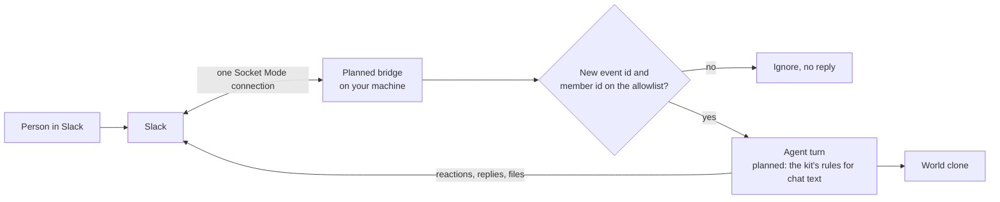

# Slack bridge (planned)

This page is for anyone who wants to know whether and how they will be able to direct their agents from a Slack workspace, for contributors who want to help build that, and for reviewers who want to see exactly which permissions we would ask for. You will learn what exists today, what is planned, what each permission in the example Slack app manifest is for, and which rules from Slack we intend to follow.

> **Status: planned.** The Slack bridge does not exist yet. No code in this repository connects to Slack. What exists today is an example app manifest, an example file for two tokens, and an allowlist that can store Slack member ids but that nothing reads yet. Everything under "The design" is our intention and may change. See the [roadmap](community/roadmap.md) and the [open issues labeled `area:slack`](https://github.com/kdtix-open/sdlca-for-spawn/issues?q=label%3Aarea%3Aslack).

The kit is an unofficial community project. It is not made, reviewed or supported by Spawn, and it is not created by, affiliated with or supported by Slack. If you want to direct an agent today, you can do it from Spawn's own chat. See [Getting started](getting-started.md).

## What exists today, and what is planned

| Piece | Today |
| --- | --- |
| [`slack/manifest.yaml`](../slack/manifest.yaml) | **Exists.** An example Slack app manifest that asks for the permissions the planned features need. It is checked for YAML syntax in our automatic checks, and nothing else uses it yet. |
| [`slack/env.example`](../slack/env.example) | **Exists.** Names the two tokens a Slack app needs (`SDLCA_SLACK_BOT_TOKEN` and `SDLCA_SLACK_APP_TOKEN`) and says where to keep them (`$SDLCA_SPAWN_HOME/slack/sdlca-slack.env`). Nothing reads the file yet. |
| `sdlca-allow slack add` and `sdlca-allow slack remove` | **Exist.** They store Slack member ids in `allowlist.json`. Nothing reads that part of the file yet. |
| `slack_channel_ids` in `worlds.json` | **Reserved.** An empty list that the planned bridge could use to link a channel to a world. |
| The bridge itself: a Socket Mode connection, slash commands, reactions, file exchange, canvases | **Planned.** Not written. |

## The design

This is what we intend. Some choices are still open, and we say so below.



In words, and all of it planned: Slack sends events to the bridge over one connection that the bridge opens. The bridge ignores an event it has seen before, and an event from anyone who is not on the allowlist. For the rest it runs one agent turn, with the same agent command and the same rules about untrusted text that apply to Spawn chat, and it reports back in Slack.

**One Socket Mode connection.** Slack's Socket Mode lets an app receive events over a connection that the app itself opens, so your machine needs no public web address and no open inbound port. The bridge would open one connection for one Slack app in one workspace. That differs from the Spawn side of the kit, where there is one listener per Spawn account.

**Dedupe by event id.** Slack can send the same event more than once, for example when it does not hear an acknowledgment in time. Each event carries an id. The bridge would acknowledge quickly and keep a list of ids it has handled, as `sdlca-on-chat` already does for Spawn events (`handled.ids`). A repeated event would not run the agent a second time.

**An allowlist of Slack member ids.** Only people on the list could start work. Slack names change and member ids do not, so the list holds ids, with the name beside each id only for humans. The list starts empty, and an empty list means nobody. Like the Spawn side, an event from someone else would be ignored without a reply. You can fill in the list today, although nothing reads it yet:

```bash
bin/sdlca-allow slack add carol U0123ABCD
bin/sdlca-allow slack remove U0123ABCD
bin/sdlca-allow list
```

A member id is the letter `U` or `W` followed by letters and digits. Slack shows it in a person's profile (check Slack's help for where). The `slack` part of the file also has a `workspace` field that no command sets yet.

**Slash commands, as examples.** The example manifest defines `/sdlca-build` ("help me build xyz") and `/sdlca-play` ("join a game or test play what we just built"). They show the idea: a short command that starts a turn about building or playing. The names are examples, and you can rename them in your own copy. What a person types after the command is chat text like any other, so it is untrusted data.

**Emoji reactions as status.** The bridge would add a reaction to the message it is working on, for example one for "received", one for "working", one for "done" and one for "needs you" (the exact emoji are not decided). A reaction alone is not enough, because some people cannot see colors or emoji well, and a reaction carries no detail. So each state would also be said in words in the thread.

**File exchange with Spawn assets.** A file shared in Slack could be uploaded to a world as an asset, and an asset or a screenshot could be posted back to Slack. Spawn's agent guide describes uploading your own files to a world as assets, which needs editor standing on that world ([Spawn's agent guide](https://www.spawn.co/llms-full.txt), retrieved 2026-11-17). Only share files you have the right to share, and do not move other people's world content into Slack.

**Canvases for epic task lists.** An epic is a large piece of work made of many tasks. The bridge would keep an epic's task list on a Slack canvas in the channel, so the list sits where the team talks.

**Threads.** One thread would be one piece of work. Replies, status and follow-ups would stay in the thread, so a channel stays readable.

**A person confirms before things go live.** The example manifest turns on interactivity so a message can carry buttons. The plan is to ask for a confirmation before a change that goes live is pushed. Whether a smaller approver list, separate from the allowlist, may press the button is an open question. We lean toward yes: see [the reasoning below](#prompt-injection-and-the-allowlist).

**Tokens stay out of Slack.** The bridge would never ask for a token, an invite code or any other session, join or login credential in a message, and the agent is told never to print a token.

## The example manifest, scope by scope

[`slack/manifest.yaml`](../slack/manifest.yaml) is the example. The tables below say what each part is for, and which planned feature needs it. The plain-words description of each scope and event is our reading of Slack's documentation, which we have not re-checked since 2026-11-17. Slack's [scopes reference](https://docs.slack.dev/reference/scopes) and [manifest reference](https://docs.slack.dev/reference/app-manifest/) are the authority. The link from a feature to a scope is our design intent, and the last column shows which scopes and events the smaller starter set below keeps.

### Bot scopes

| Scope | What it allows, in plain words | Planned feature that needs it | In the starter set |
| --- | --- | --- | --- |
| `app_mentions:read` | See messages that mention the app | Starting work by mentioning the app in a channel | Yes |
| `chat:write` | Post messages as the app | Replies, summaries and questions | Yes |
| `reactions:write` | Add emoji reactions | Status reactions | Yes |
| `commands` | Add slash commands | `/sdlca-build` and `/sdlca-play` | No |
| `im:history` | Read messages in direct messages with the app | Conversations in a direct message (with the `message.im` event) | No |
| `im:read` | See basic information about direct messages with the app | Finding the right direct message to answer in | No |
| `im:write` | Start direct messages | Sending a result or a confirmation request privately | No |
| `groups:history` | Read messages in private channels the app is in | Following a thread in a private channel without a new mention (with `message.groups`) | No |
| `groups:read` | See basic information about private channels the app is in | Linking a private channel to a world | No |
| `channels:read` | See basic information about public channels | Linking a public channel to a world, and noticing joins | No |
| `reactions:read` | Read reactions | Taking a reaction as a quick answer to a confirmation (with `reaction_added`) | No |
| `files:read` | Read files shared where the app is | Sending a Slack file to a world as an asset | No |
| `files:write` | Upload files | Posting screenshots and assets into Slack | No |
| `canvases:read` | Read canvases | Reading an epic's task list | No |
| `canvases:write` | Create and edit canvases | Keeping an epic's task list | No |
| `users:read` | See who is in the workspace | Showing a name where the app has only an id. The allowlist itself needs only ids | No |

### Events

| Event | When Slack sends it | Planned feature that needs it | In the starter set |
| --- | --- | --- | --- |
| `app_mention` | Someone mentions the app | Starting work by mention | Yes |
| `message.im` | A message in a direct message with the app | Direct-message conversations | No |
| `message.groups` | A message in a private channel the app is in | Thread follow-ups in private channels | No |
| `reaction_added` | Someone adds a reaction | Reactions as confirmation | No |
| `file_shared` | A file is shared | Sending a file to a world | No |
| `file_change`, `file_deleted` | A file is changed or removed | Keeping a file exchange current, and dropping what was removed | No |
| `member_joined_channel` | Someone, including the app, joins a channel | Noticing when the app is added to a channel, so it can ask which world the channel is for | No |

### Features and settings

| Setting | Value in the example | Why |
| --- | --- | --- |
| Bot user | `sdlca-agent`, always online | A neutral name with no vendor name in it. A bot named for a vendor would suggest that the vendor is speaking |
| App Home | Messages tab on, Home tab off | Allows direct messages with the app and has no dashboard |
| Slash commands | `/sdlca-build`, `/sdlca-play` | See above |
| Interactivity | On | Buttons for confirmation |
| Socket Mode | On | One connection, no public address |
| Token rotation | Off | As we understand it, rotating tokens would need refresh logic in the bridge. Revisit it when the bridge exists |
| Org-wide deployment | Off | The app is for one workspace |
| MCP | Off | The kit has no use for Slack's MCP feature |

### A limit for public channels

The example asks for message history in private channels and in direct messages (`groups:history`, `im:history` and the `message.groups` and `message.im` events). It does **not** ask for history in public channels. So in a public channel, the app would see only messages that mention it and slash commands, and not a thread reply that forgets to mention it.

To follow public threads without a new mention, add the `channels:history` scope and the `message.channels` event. Know the cost: the app could then read every message in each public channel it has joined, not only the ones addressed to it. Only add them if you need follow-ups there, and keep the allowlist short.

## A smaller starter manifest

If you want the least access that still works, start with mention-only. This manifest reads messages that mention the app, answers, and shows status with reactions. It has no slash commands, files, canvases, direct messages, history or buttons. It is also planned, because it works with a bridge that does not exist yet.

```yaml
# Smaller starter manifest for the planned Slack bridge: reacts to mentions only.
_metadata:
  major_version: 2
  minor_version: 1
display_information:
  name: SDLCA agent kit
  description: Direct your own AI coding agents from a Slack channel. Unofficial community project.
  long_description: |-
    *SDLCA agent kit (unofficial)* is an example Slack app for an open-source kit that lets a person direct AI coding agents from a Slack workspace. The agents run on your own machine with your own accounts. The bridge is still in development. Independent project under the Apache License 2.0, not created by, affiliated with, or supported by Slack Technologies, LLC or Spawn (AI Tools, Inc.).
features:
  bot_user:
    display_name: sdlca-agent
    always_online: true
oauth_config:
  scopes:
    bot:
      - app_mentions:read
      - chat:write
      - reactions:write
settings:
  event_subscriptions:
    bot_events:
      - app_mention
  interactivity:
    is_enabled: false
  org_deploy_enabled: false
  socket_mode_enabled: true
  token_rotation_enabled: false
```

Adjust the names to your own. Slack's reference gives limits for these fields: a name of at most 35 characters, a description of at most 140, and a long description of 175 to 4000 ([Slack manifest reference](https://docs.slack.dev/reference/app-manifest/), read on 2026-11-17 through a summary, so check them in Slack's own screens). Do not put "Slack" in your app's name. See the terms below.

## Create the app and keep the tokens

None of this is needed until the bridge exists. We write it down now so you can see what it will take.

1. In Slack's app settings (see [Slack's documentation on manifests](https://docs.slack.dev/reference/app-manifest/)), choose to create an app from a manifest. Pick your workspace, paste the contents of `slack/manifest.yaml` or the starter manifest above, and create the app.
2. Install the app to your workspace. Slack then shows a bot token, which starts with `xoxb-`.
3. In the app's settings, create an app-level token with the scope that Slack requires for Socket Mode (we understand it to be `connections:write`). It starts with `xapp-`.
4. Put both tokens in one private file, outside the repository. The example file `slack/env.example` names them `SDLCA_SLACK_BOT_TOKEN` and `SDLCA_SLACK_APP_TOKEN`:

   ```bash
   mkdir -p ~/.sdlca/spawn/slack && chmod 700 ~/.sdlca/spawn/slack
   cp slack/env.example ~/.sdlca/spawn/slack/sdlca-slack.env
   chmod 600 ~/.sdlca/spawn/slack/sdlca-slack.env
   ```

   Then edit the file in your editor and replace the quoted placeholders. The path is `$SDLCA_SPAWN_HOME/slack/sdlca-slack.env`. Nothing reads this file yet.
5. Invite the app to the channels where you want it, and add your own member id to the allowlist.

The steps and screen names are from our memory of Slack's interface and may differ. Follow Slack's own pages if they disagree.

Rules for the two tokens:

- **Never put a token in chat, in an issue, in a pull request or in a screen share,** and the same goes for any other session, join or login credential, including values printed by `spawn client join`. Not in Slack, not in Spawn, not on GitHub. The helper `scripts/check-secrets.sh` looks for Slack token patterns, among others, in files that git would commit, but it cannot see what you type into a chat.
- **Keep the file at mode 0600,** in a folder of mode 0700, owned by the user who runs the bridge.
- **Do not store provider keys in it.** The example file says so: point `SDLCA_CREDENTIALS_FILE` in the account env file at the one file where you already keep them. See [Configuration](configuration.md#provider-keys).
- **If a token leaks,** revoke or regenerate it in the app's settings in Slack at once, and tell your workspace admin.

## Slack's own terms that matter

These are the rules from Slack that shape the design. We read them on 2026-11-17, and some pages are older than a year, so they may have changed. Slack's text is the authority, not our summary. If you build on this, read the current pages.

| Topic | What we understood | Source | What we do |
| --- | --- | --- | --- |
| Training AI models | Slack's developer policy forbids using Slack data to train a large language model. Its API terms add limits for apps offered outside your own organization: no training on API data, no bulk export of messages and files, and only the data and retention you need. | [Slack's app developer policy](https://docs.slack.dev/developer-policy/) and [API terms](https://slack.com/terms-of-service/api) | The kit does not train anything and does not store Slack data. Sending text to a model to answer a request is not training. Check your own AI provider's terms on training, because some consumer plans can train on prompts unless you turn it off. |
| Distributing an app | The API terms limit commercially distributing an app that uses Slack's APIs without a Marketplace or partner agreement. A free app that connects to a paid service may count. The terms say these limits do not apply if the app, and anything connected to it, was made for use by only a single third party. | [Slack's API terms](https://slack.com/terms-of-service/api) | We do not host a Slack app for others, run no shared service and take no fees. Each person creates their own app from a manifest, for their own workspace. We have not asked Slack for a view on a published manifest. If you want to publish an app for others, read Slack's terms first. |
| Rate limits | Some Slack history methods are sharply limited for commercially distributed apps outside the Marketplace. Apps that customers build for their own organization keep their existing limits. | [Slack's changelog on rate limits](https://docs.slack.dev/changelog/2025/05/29/rate-limit-changes-for-non-marketplace-apps/) | The design uses events, not polling. |
| Names and branding | The Brand Terms say: do not imply that Slack endorses or is affiliated with your app, and do not use Slack's logo or an icon that resembles it. Use "Slack" as an adjective, as in "Slack workspace". The Marketplace guidelines (for Marketplace apps) give "Task notifications for Slack" as a better name than "Slack task notifications", so that Slack's name comes last. They also advise putting the name of an integrated service in the app name. | [Slack brand terms](https://slack.com/terms-of-service/slack-brand), [Slack Marketplace app guidelines](https://docs.slack.dev/slack-marketplace/slack-marketplace-app-guidelines-and-requirements) | The app is named "SDLCA agent kit", with no vendor name in it, and uses no Slack logo. Keeping vendor names out of the name is our own choice, not a Slack rule. It deliberately differs from the Marketplace advice to name the integrated service, because Spawn's Terms bar using Spawn's names with a product that is not Spawn's (sections 2(c) and 16; see [the Spawn rules](compliance/spawn-rules.md)). The manifest says the project is not created by, affiliated with, or supported by Slack, and carries the line Slack asks for: "Slack is a trademark and service mark of Slack Technologies, Inc., registered in the U.S. and in other countries." |
| Asking for scopes | Ask only for the scopes you use. | [Slack app developer policy](https://docs.slack.dev/developer-policy/) | The starter set above. Add scopes only when a feature needs them. |

## Prompt injection and the allowlist

A bridge turns messages from a busy chat into work done by an agent that can edit files and run commands. The main risk is *prompt injection*, which means text that tries to give the agent new instructions. We studied how other open-source Slack-to-agent projects handle it, to decide what to adopt. Their patterns, with sources (read on 2026-11-17 for our research), and where each lands in our plan:

| Pattern | Seen in | Our plan |
| --- | --- | --- |
| Deny by default, and an empty list blocks everyone | The README of [chicane](https://github.com/dinnyosz/chicane): "If empty, all messages are blocked" | Adopt. The Slack allowlist starts empty, and an empty list means nobody |
| Gate on who sent a message, not on which channel it is in | [Claude Code's Channels documentation](https://code.claude.com/docs/en/channels), which warns that trusting a whole room lets anyone in it inject messages | Adopt. The allowlist holds member ids, so joining a channel gives no power |
| Treat history and chat text as untrusted, and leave out messages from people who are not allowed | chicane and others | Adopt. Thread history would go to the agent as data, without lines from people off the list |
| Refuse unsafe settings at start-up, such as full autonomy with several allowed people | chicane | Planned idea. The bridge would refuse to start in that combination |
| Let only a smaller approver list approve risky actions | Claude Code's Channels documentation, for approving tool use | Open question, and we lean toward yes |
| Put the agent in a container, because OS-level isolation beats an allowlist | [NanoClaw](https://github.com/nanocoai/nanoclaw) | Recommended in [Security model](security-model.md#hardening-checklist) |
| Say plainly that an allowed person has the power of the agent's machine access | chicane says it is "equivalent to giving them shell access to your machine" | Adopt. The bridge's documentation would say the same |

What we do on the Spawn side already carries over: the kit fences untrusted text in the prompt, never lets text choose where the agent works, and fails closed. [Security model](security-model.md) explains each of those and the risks that remain. An allowlist and a fenced prompt reduce the risk. They do not remove it, and the bridge would not change that.

## How to help

The Slack bridge is the biggest planned piece of work. If you would like to help, read the [roadmap](community/roadmap.md), look at the [issues labeled `area:slack`](https://github.com/kdtix-open/sdlca-for-spawn/issues?q=label%3Aarea%3Aslack), and say hello in [Discussions](https://github.com/kdtix-open/sdlca-for-spawn/discussions) before you start, so we can agree on the design. The [development guide](contributing/development.md) covers the setup. Please keep real tokens (and any other session, join or login credential, including values printed by `spawn client join`) and real Slack data out of issues, pull requests and tests: tests use shims and local servers only.

Slack is a trademark and service mark of Slack Technologies, Inc., registered in the U.S. and in other countries. The kit is not created by, affiliated with, or supported by Slack Technologies, LLC.

Unofficial community project, not affiliated with Spawn. Licensed under Apache-2.0.
